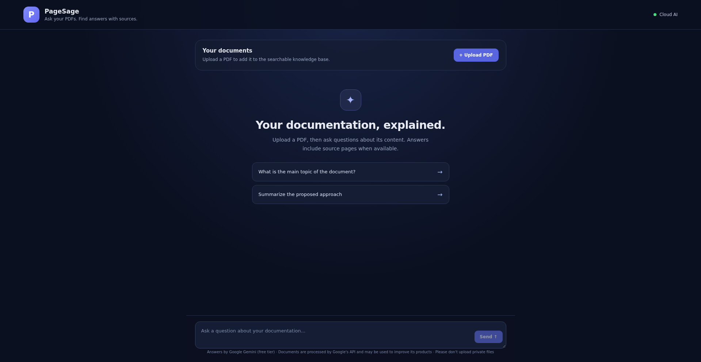
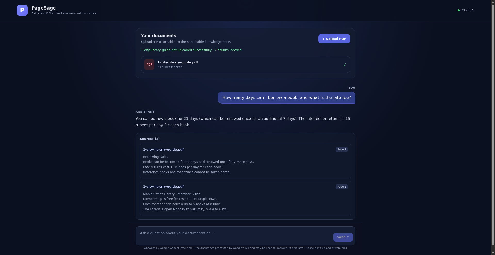

# PageSage

PageSage is an AI-powered chatbot that answers user questions based on information retrieved from uploaded documents using Retrieval-Augmented Generation (RAG). Ask your PDFs, and get answers with their source pages.

[](https://rag-documentation-chatbot.vercel.app)

## Screenshots

### Home screen



### Answer with sources



## Features

- Retrieve relevant information from PDF documents.
- Answer questions using document content.
- FastAPI backend for API operations.
- React frontend for user interaction.
- Vector storage for document retrieval.

## Technologies Used

- **Language:** Python, JavaScript
- **Backend:** FastAPI
- **Frontend:** React, Vite
- **Libraries:** LangChain, ChromaDB, Sentence Transformers, PyMuPDF

## Project Structure

```text
rag-documentation-chatbot/
├── backend/
│   └── app/
│       ├── main.py            # the whole FastAPI app lives in this one file
│       └── requirements.txt
├── frontend/                  # React + Vite app
│   └── src/
│       ├── App.jsx            # the main chat screen
│       ├── App.css
│       └── main.jsx
├── documents/                 # bundled sample.pdf for first-time demos
├── docs/                      # screenshots used in this README
├── render.yaml                # Render deployment blueprint
├── START-HERE.txt
├── README.md
└── .gitignore
```

## Installation and Setup

### 1. Clone the Repository

```bash
git clone https://github.com/laya-khathoon/rag-documentation-chatbot.git
cd rag-documentation-chatbot
```

### 2. Start the Backend

Get a free Gemini API key from Google AI Studio
(https://aistudio.google.com) and set it as an environment variable:

```bash
export GOOGLE_API_KEY="your-key-here"
```

Then install the dependencies and start the server:

```bash
cd backend
pip install -r app/requirements.txt
uvicorn app.main:app --reload
```

Backend URL: http://127.0.0.1:8000

API documentation: http://127.0.0.1:8000/docs

### 3. Start the Frontend

Open a new terminal:

```bash
cd frontend
npm install
npm run dev
```

Open the local URL displayed in the terminal.

## How It Works

1. An uploaded PDF is split into small text chunks.
2. Each chunk is turned into an embedding (a list of numbers that
   captures its meaning) with Google's embedding model and stored in a
   Chroma vector database.
3. A question is embedded the same way, and the database returns the
   most similar chunks.
4. The Gemini language model writes the answer using only those chunks,
   and the app lists the source pages.

## Deployment

PageSage is live at https://rag-documentation-chatbot.vercel.app

- Frontend: Vercel, with
  the backend address set in the VITE_API_URL environment variable.
- Backend: Render free web service (see render.yaml). The
  GOOGLE_API_KEY environment variable must be set in the Render
  dashboard. Free services sleep after 15 minutes without traffic and
  take about a minute to wake up.
- Privacy: each visitor's uploads are stored in their own session
  collection, and the bundled documents/sample.pdf powers first-time
  demos. On the Gemini free tier, Google may use content to improve its
  products - do not upload private documents.

## Future Improvements

- Restore reranking of retrieved chunks.
- Support multiple PDF documents per session with delete/clear.
- Show upload history per session.

## Author

Laya Khathoon V
